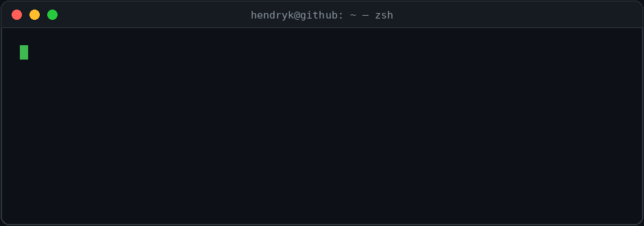

<div align="center">
  
</div>

<p align="center">
  <a href="https://github.com/hendrykcosta75">
    
  </a>
  
  
</p>

---

## // manifest

```yaml
apiVersion: agents.dev/v1
kind: Engineer
metadata:
  name: hendryk-costa
  labels:
    university: "Engenharia da Computação — UFAL"
    technical-degree: "Desenvolvimento de Sistemas — IFAL"
    location: "Alagoas, BR"
spec:
  focus:
    - AI agents & harness engineering
    - backend & distributed systems
    - cloud infra & observability
  languages: [Rust, Go, TypeScript, Python, PHP]
status:
  phase: Building
  ready: "True"
```

## // agents & harness engineering

> designing, deploying and operating autonomous AI agents in production —
> harnesses, orchestration, tool use, memory & evals.
> the agent does the work; the harness makes it reliable.

## // stack

**languages**

<p>
  
</p>

**backend & frontend**

<p>
  
</p>

**infra, cloud & observability**

<p>
  
</p>

**data**

<p>
  
</p>

## // telemetry

<div align="center">
  
</div>

<div align="center">
  
</div>

---


<!-- stack icons: skillicons.dev · cards: github-profile-summary-cards · views: komarev.com/ghpvc · banner: hand-rolled terminal gif (assets/banner.gif) -->
<!-- nota: github-readme-stats (Vercel) está pausado e streak-stats.demolab.com está lento demais para o proxy do GitHub (~25s → 504); reavaliar depois. -->
